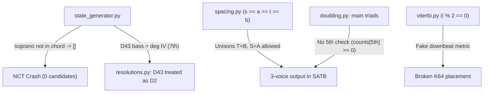

# Red Team Audit: Авторитетный свод правил строгой классической гармонии (SATB) vs Реализация в кодовой базе движка

> **Исследователь:** Музыкальный теоретик-исследователь Red Team  
> **Объект аудита:** Алгоритмическое ядро гармонизации (`src/harmony/rules/`, `src/harmony/solver/`, `src/harmony/syntax/`, `docs/BRIGADE_RULES.md`)  
> **Нормативная база:** «Бригадный» учебник (И. Дубовский, С. Евсеев, И. Способин, В. Соколов), Н. А. Римский-Корсаков, П. И. Чайковский, W. Piston, S. Kostka & D. Payne, E. Aldwell & C. Schachter, D. Temperley, C. Raphael, M. Allan & C. Williams.

---

## 1. Авторитетные академические источники

Для исключения вкусовщины и субъективизма аудит опирается на первоисточники отечественной и мировой теории гармонии:

1. **Дубовский И., Евсеев С., Способин И., Соколов В. «Учебник гармонии» («Бригадный»)**. — М.: Музыка, 1965 (переизд. 2012).  
   *Фундамент советской и российской консерваторской школы. Строгий мажоро-минорный 4-голосный хорал (SATB).*  
   URL: [Бригадный учебник гармонии (НСПУ)](https://lib.nspu.ru) / [Электронный каталог РГБ](https://www.rsl.ru)
2. **Римский-Корсаков Н. А. «Практический учебник гармонии»**. — СПб., 1886; под ред. М. Штейнберга, М.: Музгиз, 1956.  
   *Академический базис голосоведения Петербургской школы, законы акустического сродства и строгих запретов.*  
   URL: [IMSLP: Practical Manual of Harmony (Rimsky-Korsakov)](https://imslp.org/wiki/Practical_Manual_of_Harmony_(Rimsky-Korsakov,_Nikolay))
3. **Чайковский П. И. «Руководство к практическому изучению гармоний»**. — М., 1872.  
   *Первый отечественный практический учебник Московской консерватории. Четкие правила голосоведения и запретов.*  
   URL: [IMSLP: Guide to the Practical Study of Harmony, TH 255 (Tchaikovsky)](https://imslp.org/wiki/Guide_to_the_Practical_Study_of_Harmony,_TH_255_(Tchaikovsky,_Pyotr))
4. **Walter Piston, Mark DeVoto. "Harmony" (5th Edition)**. — W. W. Norton & Company, 1987.  
   *Американский англоязычный стандарт голосоведения (Voice Leading, Direct Fifths/Octaves, Texture Spacing).*  
   URL: [W. W. Norton: Piston Harmony](https://wwnorton.com)
5. **Stefan Kostka, Dorothy Payne, Byron Almén. "Tonal Harmony: With an Introduction to Twentieth-Century Music" (8th Edition)**. — McGraw-Hill, 2018.  
   *Современный университетский канон анализа голосоведения, типичных ошибок и правил удвоений.*  
   URL: [McGraw-Hill Education: Tonal Harmony](https://www.mheducation.com/highered/product/tonal-harmony-kostka-payne/M9781259447099.html)
6. **Edward Aldwell, Carl Schachter, Allen Cadwallader. "Harmony and Voice Leading" (4th Edition)**. — Cengage Learning, 2011.  
   *Шенкерианский подход к строгому голосоведению, линеарности и неаккордовым тонам.*  
   URL: [Cengage: Harmony and Voice Leading](https://www.cengage.com)
7. **Moray Allan, Christopher K. I. Williams. "Harmonising Chorales by Probabilistic Inference"**. — Advances in Neural Information Processing Systems (NIPS 2004 / MIT Press, 2005).  
   *Классическая работа по генерации 4-голосных хоралов Баха на основе Hidden Markov Models (HMM) и Viterbi.*  
   URL: [NIPS Proceedings Paper 2004](https://papers.nips.cc/paper/2004/hash/bf8229696f7a3bb4700cfddef19fa23f-Abstract.html)
8. **Christopher Raphael, Josh Stoddard. "Harmonic Analysis with Probabilistic Graphical Models"**. — Proc. ISMIR 2003.  
   *Оптимальное распознавание и синтез гармонии через динамическое программирование и графовые модели.*  
   URL: [ISMIR Proceedings Archive](https://ismir.net)
9. **David Temperley. "The Cognition of Basic Musical Structures"**. — MIT Press, 2001; *"A Unified Probabilistic Model for Polyphonic Music Analysis"*, JNMR, 2009.  
   *Математическое моделирование музыкальных предпочтительных правил (Preference Rules) и гармонического метра.*  
   URL: [MIT Press: The Cognition of Basic Musical Structures](https://mitpress.mit.edu/9780262701051/the-cognition-of-basic-musical-structures/)
10. **David Cope. "Experiments in Musical Intelligence" (EMI)**. — A-R Editions, 1996; *"The Algorithmic Composer"*, 2000.  
    *Пионерская методология рекомбинантного анализа и строгого контроля правил в алгоритмической композиции.*  
    URL: [A-R Editions Computer Music Series](https://www.areditions.com/cope-experiments-in-musical-intelligence-cs012.html)

---

## 2. Свод правил строгой классической гармонии (Канон vs Реализация в коде)

### 2.1. Параллельные квинты и октавы (Parallel 5ths & 8ves)
* **Канон (Бригадный, гл. 3; Римский-Корсаков, гл. 1; Чайковский, гл. 1):**  
  Движение двух голосов в одном направлении (параллельное или прямое) от одной чистой квинты/октавы к другой чистой квинте/октаве (включая составные интервалы — дуодецимы, двойные октавы, унисоны) **категорически запрещено**.  
  - Запрет действует **между всеми 6 парами голосов**: $(S-A, S-T, S-B, A-T, A-B, T-B)$. Заявления, что «внутренним голосам параллельные квинты разрешены» — безграмотная ересь.
  - **Исключения и тонкости:**
    1. $ч.5 \to ум.5$ — разрешено, если тритон разрешается сужением внутрь (например, $I \to II_6$ или $T \to S_6$).
    2. $ум.5 \to ч.5$ — в строгом стиле Бригадного учебника **избегается**, допускается лишь в одном конкретном обороте: $II_6 \to T$ при плавном шаге верхнего голоса на секунду вверх при поступенном басе.
    3. Октава через повтор ноты (косое движение, oblique): если один голос неподвижен ($d_1 = 0$), параллелизма нет.
* **Что нагорожено в коде (`src/harmony/rules/voice_leading.py:25-76`):**  
  Код проверяет `d1 * d2 > 0` и `int_prev == 7 and int_curr == 7` (либо `0 and 0`), где интервал берется по модулю 12 (`abs(p1 - p2) % 12`).  
  **Косяк реализации:** Ход $ум.5 \to ч.5$ (интервал 6 переходит в 7) код вслепую пропускает, поскольку `6 == 7` дает `False`! Проверок на ладовое разрешение тритона нет вовсе.

### 2.2. Противоположные квинты и октавы (Contrary 5ths & 8ves)
* **Канон (Бригадный, гл. 3; Римский-Корсаков, гл. 1, §4; Kostka-Payne, ch. 6):**  
  Движение двух голосов в противоположные стороны от одной чистой октавы (квинты) к другой чистой октаве (квинте) запрещено так же строго, как и параллельное (так как разрушает независимость голосов и дает акустический эффект октавного удвоения).
* **Математический разбор кода (`voice_leading.py:79-130`):**  
  В функции `check_contrary_fifths_and_octaves` прописано: `d1 * d2 < 0` и `int_prev == int_curr` (где `int = abs(p1 - p2) % 12 == 7` или `0`).  
  Пусть $I_{prev} = p_1 - p_2$, $I_{curr} = c_1 - c_2$.  
  Изменение интервала: $\Delta I = I_{curr} - I_{prev} = (c_1 - p_1) - (c_2 - p_2) = d_1 - d_2$.  
  Так как движение противоположное ($d_1 \cdot d_2 < 0$), знаки у $d_1$ и $d_2$ противоположны, следовательно:  
  $$|\Delta I| = |d_1 - d_2| = |d_1| + |d_2|$$  
  Чтобы интервал остался тем же самым по модулю 12 ($int_{prev} = int_{curr}$), необходимо:  
  $$(|d_1| + |d_2|) \equiv 0 \pmod{12}$$  
  Поскольку голоса сдвинулись ($|d_1| + |d_2| > 0$), минимальная сумма скачков обязана равняться **12 полутонам**!  
  **Приговор:** При обычном плавном голосоведении (шаги на 1–3 полутона, где $|d_1| + |d_2| \le 6$) эта проверка **математически не может сработать никогда** — это на 99% мертвый код!  
  Она сработает только тогда, когда два голоса одновременно совершат дикие скачки навстречу или врозь на суммарную величину $\ge 12$ полутонов (например, бас скачет на квинту вниз $-7$, тенор на кварту вверх $+5$).  
  **Грубый ложный дефект:** Из-за `% 12` код считает унисон (0) и октаву (12) одним и тем же числом. Если голоса сходятся из октавы (12 пт) в унисон (0 пт) противоположным движением (например, сопрано $-5$, бас $+7$, сумма 12), код орет `CONTRARY_OCTAVES`, хотя голоса пришли в унисон, сменив октаву на приму!

### 2.3. Скрытые (прямые) квинты и октавы (Hidden / Direct 5ths & 8ves)
* **Канон (Бригадный, гл. 3, §3; Чайковский, гл. 1; Piston, ch. 7; Aldwell-Schachter, ch. 5):**  
  Скрытыми называются квинта или октава, возникающие при **прямом движении крайних голосов** ($S$ и $B$) от любого другого интервала.  
  - **Золотое правило:** Скрытые квинты и октавы **запрещены только тогда, когда сопрано делает скачок** (на терцию или шире).  
  - Если сопрано движется **поступенно (на секунду)**, скрытая квинта или октава **полностью разрешена**!  
  - Между средними голосами ($S-A$, $A-T$, $T-B$) скрытые квинты и октавы в классическом 4-голосии **не запрещаются**.
* **Что в коде (`voice_leading.py:133-170`):**  
  Код проверяет только $S$ и $B$ (`voices=(0, 3)`), условие `abs(ds) > 2`.  
  В целом это соответствует канону (скачок $> 2$ полутонов = терция и шире). Однако код оперирует физическими полутонами, а не ступенями лада: в миноре увеличенная секунда (3 полутона) трактуется как скачок, а уменьшенная терция (2 полутона) — как шаг. Кроме того, в коде нет исключения для каденционных оборотов ($V \to I$), где скачок баса при шаге сопрано абсолютно легален.

### 2.4. Правила удвоений (Doubling Rules)
* **1. Главные трезвучия ($T, S, D$) в основном виде ($5/3$):**  
  - **Канон (Бригадный, гл. 2, 4; Римский-Корсаков, гл. 1):** Строго удваивается **прима (основной тон)**. Удвоение терции категорически запрещено (в $D$ терция — вводный тон; в $T$ и $S$ утяжеляет фактуру). Трезвучие $5/3$ обязано быть **полным**: 2 примы, 1 терция, 1 квинта! Неполное трезвучие с утроенной примой (3 примы, 1 терция, 0 квинт) допускается исключительно как заключительный аккорд произведения.  
  - **ДЫРА В КОДЕ (`doubling.py:101-175`):**  
    `check_main_triad_doubling` проверяет лишь `counts[third] < 2` и `counts[root] >= 2`.  
    Наличие квинты `counts[fifth] >= 1` **НЕ ПРОВЕРЯЕТСЯ ВООБЩЕ**!  
    В результате движок признает эталонным аккорд $C-C-E-C$ (утроенная тоника, бас и тенор в унисоне $C_3$, квинты $G$ нет вовсе) прямо посреди такта! Именно этот кадавр вылез в топ-1 на дефолтной мелодии!
* **2. Секстаккорды ($T_6, S_6, D_6$):**  
  - **Канон:** Удваивается прима или квинта. Удвоение терции (баса) в $T_6$ и $S_6$ нежелательно, но допускается при плавном голосоведении или при переходе $T \to T_6$. В $D_6$ терция — вводный тон, её удвоение — **абсолютное табу**.  
  - В $II_6$ (секстаккорд второй ступени) канон Бригады (§18) **требует удваивать терцию** (бас, IV ступень лада — субдоминантовый центр)!  
  - **В коде (`doubling.py:316-395`):** Для $T_6/S_6$ удвоение баса сделано безусловным hard gate, а для $II_6$ отдельного правила удвоения субдоминантовой терции просто не существует.
* **3. Прерванный оборот ($D \to VI$):**  
  - **Канон (Бригадный, гл. 13):** В трезвучии $VI$ ступени **СТРОГО УДВАИВАЕТСЯ ТЕРЦИЯ** (I ступень лада / тоника!). Бас идет $V \to VI$, вводный тон доминанты идет в тонику. Удвоение основного тона в $VI$ — грубейшая ошибка, ведущая к параллельным квинтам/октавам.  
  - **В коде (`doubling.py:214-259`):** Реализовано эталонно (`check_deceptive_vi_doubling` требует удвоения тоники).
* **4. Септаккорды ($D_7$):**  
  - **Канон:** Полный (1, 1, 1, 1) или неполный (2 примы, 1 терция, 1 септима, квинта пропущена). Обращения ($65, 43, 2$) применяются **исключительно в полном виде**. В коде (`doubling.py:398-478`) это правило соблюдено.

### 2.5. Каденционный квартсекстаккорд ($K_{6/4}$)
* **Канон (Бригадный, гл. 9; Римский-Корсаков, гл. 2; Kostka-Payne, ch. 9):**  
  1. **Метрика:** Ставится **только на сильной или относительно сильной доле** по отношению к разрешающей доминанте ($D$ или $D_7$). Не может появиться на слабой доле перед доминантой на сильной!  
  2. **Удвоение:** **Строго удваивается бас** (V ступень лада / квинта тонического состава). Удвоение терции или кварты строго воспрещено.  
  3. **Разрешение:** Бас остается на месте (или скачет на октаву), квартовый тон (I) идет на секунду вниз в VII, секстовый тон (III) идет на секунду вниз во II.  
* **Косяк в коде (`engine.py:90`, `viterbi.py:68, 71`):**  
  Правило удвоения соблюдено, но проверка метрики — позор: `is_downbeat` в Viterbi вычисляется как `i % 2 == 0`. В трехдольных метрах (3/4, 3/8) или шестидольных (6/8) это выдает бред: доли 0 (сильная), 1 (слабая), 2 (слабая) получают флаги True, False, True — сильной объявляется третья слабая доля!

### 2.6. Разрешения диссонансов: Катастрофа $D_{4/3}$ vs $D_2$
* **Канон гармонии (Бригадный, гл. 12, 14, 15; Римский-Корсаков, гл. 3):**  
  Септаккорд $D_7$ в До мажоре состоит из звуков: $G$ (прима), $B$ (терция), $D$ (квинта), $F$ (септима).  
  - **$D_{6/5}$ (квинтсекстаккорд):** бас — терция ($B$, VII ст.). Разрешается в $T_{5/3}$ (бас идет в $C$).  
  - **$D_{4/3}$ (терцквартаккорд, 2-е обращение): БАС — КВИНТА СЕПТАККОРДА ($D$, II СТУПЕНЬ ЛАДА)!**  
    Разрешается в **полное тоническое трезвучие $T_{5/3}$** (бас идет вниз $D \to C$), либо при проходящем басе — в $T_6$ (бас идет вверх $D \to E$). Септима ($F$) идет вниз в $E$.  
  - **$D_2$ (секундаккорд, 3-е обращение): БАС — СЕПТИМА СЕПТАККОРДА ($F$, IV СТУПЕНЬ ЛАДА)!**  
    Разрешается **строго в тонический секстаккорд $T_6$**, бас обязан шагнуть на секунду вниз в терцию тоники ($F \to E$).
* **КАТАСТРОФИЧЕСКИЙ БАГ В КОДЕ (`resolutions.py:67-124` и `state_generator.py:101-105`):**  
  Разработчики перепутали терцквартаккорд с секундаккордом!  
  В `state_generator.py:101-103`:
  ```python
  elif "43" in sym_clean:
      # Per Brigade D43 convention in this engine, 7th in bass  <-- ЧУШЬ И ПОЗОР!
      required_bass_pc = (tonic_pc + 5) % 12  # Требуют Фа (IV ступень) вместо Ре (II ступень)!
  ```
  В `resolutions.py:74`: прямо в докстринге утверждается дичь:  
  *"D43 has the seventh in the bass (scale degree IV). It MUST resolve strictly to T6..."*  
  И в строке 90 `check_d43_resolution` выкидывает `hard_gate`, если аккорд разрешается в нормальное каноническое $T_{5/3}$!  
  **Следствие:** Движок физически не может сгенерировать настоящий $D_{4/3}$ (с басом Re в До мажоре). Вместо него под именем $D_{4/3}$ плодится стопроцентный дубликат секундаккорда $D_2$!

### 2.7. Мелодические ходы (Melodic Leaps)
* **Канон (Бригадный, гл. 3; Чайковский, гл. 1):**  
  - Запрещены: скачки на септиму, любые увеличенные интервалы (ув.2 в гармоническом миноре между VI и VII#, ув.4, ув.5), уменьшенные интервалы без немедленного возврата внутрь, скачки шире октавы (> 12 полутонов).  
  - Скачок на чистую октаву (12 полутонов) — **разрешен** (особенно в басу), при условии последующего шага в противоположную сторону.  
  - Запрещены два скачка подряд в одну сторону (например, две кварты или кварта + квинта = септима/нона).
* **В коде (`voice_leading.py:265-337`):**  
  Ловятся: 6 пт (тритон), 10 и 11 пт (септимы), > 12 пт, и 3 пт (ув.2 в миноре).  
  **Дыры:** Увеличенная квинта (8 пт), уменьшенная септима (9 пт), уменьшенная кварта (4 пт) и цепочки скачков не отслеживаются вообще.

### 2.8. Расположение, тесситура и фактурные унисоны
* **Диапазоны голосов:**  
  Канон Бригады: S: $C_4 - A_5$ (60–81); A: $G_3 - D_5$ (55–74); T: $C_3 - G_4$ (48–67); B: $E_2 - C_4$ (40–60).  
  В коде (`spacing.py:23`): в `EXTENDED_VOICE_RANGES` бас опущен до $C_2$ (36 пт, контроктава). Это предел для басов-октавистов в хоровой партитуре Чеснокова, а не для обычного студенческого SATB хорала.
* **Расстояния:** $S-A \le 12$, $A-T \le 12$ (октава). Для $T-B$ в коде стоит $\le 24$ пт (две октавы). Канон Бригады рекомендует не превышать дуодециму (19 пт).
* **Унисоны соседних голосов (Грубейший дефект фактуры):**  
  - В классическом 4-голосии голоса должны сохранять самостоятельность. Унисон между сопрано и альтом ($S=A$) или тенором и басом ($T=B$) уничтожает один голос фактуры.  
  - В `spacing.py:59` стоит проверка `s >= a >= t >= b` (нестрогое неравенство!).  
  - В `state_generator.py:117, 126, 135` циклы допускают равенство граничных высот.  
  - **Результат:** Движок с чистой совестью генерирует трезвучие $T_{5/3}$ с тенором и басом на одной ноте $C_3$, выкидывая квинту $G$, и Viterbi выбирает этот убогий суррогат как «оптимальный»!

### 2.9. Неаккордовые звуки (NCT): Архитектурный тупик
* **Канон (Бригадный, гл. 22–25; Piston, ch. 8–11; Aldwell-Schachter, ch. 18–21):**  
  Мелодическая линия живет за счет проходящих (passing), вспомогательных (neighbor), задержаний (suspension) и предъёмов (anticipation). Гармонический ритм (смена аккордов) **медленнее** мелодического: один аккорд держит 2, 3 или 4 ноты мелодии.
* **Архитектурный крах реализации:**  
  1. Файл `src/harmony/rules/non_chord_tones.py` написан чисто ради галочки и тестов: он **вообще не импортирован в `engine.py` и не участвует в валидации перехода**!  
  2. В `src/harmony/solver/state_generator.py:88`:  
     ```python
     # Check that soprano belongs to chord
     if soprano_pitch % 12 not in allowed_pcs:
         return []
     ```  
  3. **Следствие:** Движок категорически не способен гармонизовать мелодию, если хотя бы одна нота сопрано не входит в триаду аккорда! Мелодия с простейшей проходящей нотой гарантированно выбрасывает `candidates = []` и крашит Viterbi.

### 2.10. Viterbi / DP и rule-based гармонизация
* **Канон теории и MIR (Allan & Williams, Temperley, Raphael & Stoddard):**  
  1. **K-best Viterbi / Beam Search:** Для предоставления пользователю альтернативных решений (топ-3) алгоритм обязан сохранять $K$ лучших путей на каждом шаге решетки (алгоритм Eppstein или Yen).  
  2. **Строгое разделение Hard / Soft:** Hard gates должны отсекать ребра решетки бинарно (`is_valid = False` $\implies$ ребро удалено, $\infty$). Смешивать штраф hard gate (`100000.0`) с софт-весами недопустимо.  
  3. **Горизонт Маркова:** Классическая гармония иерархична. Биграммная модель ($t-1 \to t$) слепа к каденционным рифмам (цезура в 4-м такте, финал в 8-м), задержаниям (требующим триграммы $t-1 \to t \to t+1$) и цепочкам скачков.  
* **Косяки в реализации:**  
  - В `backend/api.py:229` автор просто берет первые 3 плана из генератора, для каждого запускает 1-best Viterbi и сортирует результаты. Это профанация K-best оптимизации!  
  - Тотальный запрет $D \to S$ в `engine.py:104` действует на ЛЮБОМ шаге без учета цезур.

---

## 3. Детальный разбор расхождений по файлам кодовой базы



1. **`src/harmony/rules/resolutions.py:67-124` & `src/harmony/solver/state_generator.py:101-105` [BLOCKER]**  
   - Бас $D_{4/3}$ приравнен к IV ступени (септима) с обязательным ходом в $T_6$. В каноне бас $D_{4/3}$ — II ступень (квинта) с разрешением в $T_{5/3}$ или $T_6$. Под видом $D_{4/3}$ движок строит дубль $D_2$.
2. **`src/harmony/solver/state_generator.py:88` [BLOCKER]**  
   - `if soprano_pitch % 12 not in allowed_pcs: return []`. Мелодия с неаккордовыми нотами на слабых долях немедленно крашится. Модуль `non_chord_tones.py` заброшен и не подключен к `RuleEngine`.
3. **`src/harmony/rules/spacing.py:59-94` & `src/harmony/rules/doubling.py:101-175` [CRITICAL]**  
   - Допущены унисоны соседних голосов ($T=B, S=A$), и не требуется наличие квинты в трезвучиях $5/3$. Движок выдает 3-голосную кашу с удвоением в унисон в топ-1.
4. **`src/harmony/rules/voice_leading.py:79-130` [HIGH]**  
   - `check_contrary_fifths_and_octaves` требует $(|d_1| + |d_2|) \equiv 0 \pmod{12}$. Не работает при шагах $\le 4$ полутонов, а при сходе октавы в приму ($12 \to 0$) дает ложное срабатывание.
5. **`src/harmony/rules/engine.py:104-116` [HIGH]**  
   - Безусловный hard-gate $D \to S$ на всех тактах без учета структуры фраз и цезур.
6. **`src/harmony/solver/viterbi.py:68, 71` [HIGH]**  
   - `is_downbeat` захардкожен на четность индекса `i % 2 == 0`, что уничтожает метрику в размерах 3/4, 6/8 и синкопах.
7. **`backend/api.py:228-245` [MEDIUM]**  
   - Вместо настоящего K-best Viterbi запускается 1-best на первых трех планах; ошибки маскируются единым alert-окном.
8. **`src/harmony/rules/voice_leading.py:288-335` [MEDIUM]**  
   - Не отслеживаются ходы на увеличенную квинту, уменьшенную септиму, уменьшенную кварту и сдвоенные скачки в одном направлении.

---

## 4. Сводная таблица: Правило → Канон → Код → Вердикт

| Правило гармонии | Канон (Бригадный, Римский-Корсаков, Piston) | Реализация в коде (`src/harmony/`) | Инженерный вердикт Red Team |
|---|---|---|---|
| **Параллельные 5 и 8** | Строго запрещены во всех 6 парах. $ум.5 \to ч.5$ избегается. | `voice_leading.py:25` — проверяет все 6 пар, но $ум.5 \to ч.5$ пропускает из-за `int == 7`. | ⚠️ **Частично годно** (базовый параллелизм ловит, переход $ум.5 \to ч.5$ проспал). |
| **Противоположные 5 и 8** | Запрещен переход $8 \to 8$ и $5 \to 5$ противоположным ходом. | `voice_leading.py:79` — требует суммы скачков $\ge 12$ пт; путает унисон с октавой через `% 12`. | ❌ **Кривая математика** (при плавных шагах мертв; ложно блочит схождение $12 \to 0$). |
| **Скрытые квинты и октавы** | Запрещены только между $S$ и $B$, если сопрано делает скачок. | `voice_leading.py:133` — проверяет $S-B$, штрафует `abs(ds) > 2` (скачок в полутонах). | ✅ **Соответствует канону** (реализовано строго по Бригаде). |
| **Удвоение в главных $5/3$** | Удваивается прима. Трезвучие обязано быть полным (1-1-1-1). Терция табу. | `doubling.py:101` — запрещает терцию, требует приму $\ge 2$, но **не требует квинты**! | ❌ **Дыра в полноте** (пропускает кадавры без квинты с утроенной примой). |
| **Прерванный оборот ($D \to VI$)** | В $VI$ строго удваивается терция (I ступень лада / тоника). | `doubling.py:214` — требует удвоения тонического pitch class в $VI$. | ✅ **Эталонно** (строго по Бригаде, гл. 13). |
| **Бас и разрешение $D_{4/3}$** | Бас — II ступень (квинта). Разрешается в $T_{5/3}$ (ход $II \to I$) или $T_6$. | `state_generator.py:102`, `resolutions.py:67` — требует IV ступень в басу и ход в $T_6$. | ❌ **Катастрофический бред** (перепутали терцквартаккорд с секундаккордом). |
| **Разрешение $D_2$** | Бас — IV ступень (септима). Шаг на секунду вниз в терцию тоники ($T_6$). | `resolutions.py:125` — требует бас IV ступень и шаг вниз в $T_6$. | ✅ **Верно** ($D_2$ реализован правильно, но его же скопипастили в $D_{4/3}$). |
| **Метрика и бас $K_{6/4}$** | Строго на сильной доле перед $D$. Удваивается только бас (V ступень). | `engine.py:90`, `doubling.py:177` — бас удваивается, но `is_downbeat` захардкожен на `i % 2 == 0`. | ⚠️ **Инвалидная метрика** (правило верное, но расчет долей ломается на 3/4 и 6/8). |
| **Неаккордовые звуки (NCT)** | Орнаментика: проходящие, вспомогательные, задержания (1 аккорд на несколько нот). | `state_generator.py:88` — `soprano % 12 not in allowed_pcs -> []`. Модуль NCT мертв. | ❌ **Архитектурный тупик** (движок не умеет гармонизовать мелодии с NCT). |
| **Запрещенные скачки** | Септимы, тритоны, ув.2, ув.4, ув.5, скачки $> 12$ пт, два скачка подряд. | `voice_leading.py:265` — ловит 6, 10, 11, >12 и ув.2 в миноре. Ув.5 и ум.7 игнорирует. | ⚠️ **Неполный фильтр** (нет проверки энгармонизма альтераций и двух скачков). |
| **Фактурные унисоны ($T=B, S=A$)** | Не допускаются в стабильной 4-голосной фактуре как постоянное состояние. | `spacing.py:59` — нестрогие неравенства; генератор создает $T=B$ и $S=A$. | ❌ **Грубейший дефект** (выдает 3-голосие под видом 4-голосной классики). |
| **Viterbi K-Best поиск** | Нахождение глобального топа $K$ траекторий на решетке состояний. | `backend/api.py:229`, `viterbi.py` — 1-best Viterbi на первых попавшихся 3 планах. | ❌ **Фейковая оптимизация** (нет честного K-best алгоритма). |

---

## 5. Инженерный план рефакторинга ядра (Архитектурные предписания)

Чтобы превратить этот полурабочий макет в надежный академический движок, необходим хирургический рефакторинг пяти подсистем:

### 5.1. Исправление конфуза $D_{4/3}$ vs $D_2$
- В `src/harmony/solver/state_generator.py:101-103`:
  Заменить `required_bass_pc = (tonic_pc + 5) % 12` на `(tonic_pc + 2) % 12` (II ступень — квинта септаккорда).
- В `src/harmony/rules/resolutions.py:67-124`:
  Переписать `check_d43_resolution`:
  1. Разрешенными целевыми аккордами сделать `("T", "T53", "T6", "t", "t6")`.
  2. Проверять ход баса: либо вниз на секунду $II \to I$ ($delta_b \in \{-1, -2\}$ в $T$), либо вверх на секунду $II \to III$ ($delta_b \in \{+1, +2\}$ в $T_6$).
  3. Проверять обязательное разрешение септимы (IV ступень) в среднем или верхнем голосе на секунду вниз во II/III ступень.

### 5.2. Полнота трезвучий и устранение унисонного кадавра ($T=B, S=A$)
- В `src/harmony/rules/spacing.py:57-94`:
  Ввести разделение: строгая проверка на пересечение и штраф за унисоны соседних голосов. Запретить $S == A$ и $T == B$ в статических состояниях генератора, кроме заключительного унисона в каденции.
- В `src/harmony/rules/doubling.py:101-175`:
  В `check_main_triad_doubling` добавить проверку полноты:
  ```python
  if counts[fifth] < 1:
      violations.append(RuleViolation(rule_id="INCOMPLETE_MAIN_TRIAD", severity="hard_gate", ...))
  ```
  Неполное трезвучие разрешать **только** на последнем шаге мелодии (`is_final_chord=True`).

### 5.3. Архитектура неаккордовых звуков (NCT)
- Устранить блокировку `soprano_pitch % 12 not in allowed_pcs: return []` в `state_generator.py`.
- Реализовать двухслойный макро-микро парсинг:
  1. **Слой макро-гармонии (Harmonic Rhythm):** Сетка шагов Viterbi привязывается к тактовым долям (например, половинные или целые ноты).
  2. **Слой мелодической орнаментики:** Если в пределах одного гармонического шага сопрано содержит последовательность нот, промежуточные слабые ноты валидируются через `src/harmony/rules/non_chord_tones.py` как проходящие или вспомогательные.

### 5.4. Математика противоположных квинт и октав
- В `voice_leading.py:79-130`:
  Убрать модуль 12 при сравнении интервалов перехода. Проверять переход именно чистой октавы в октаву:
  ```python
  if abs(p1 - p2) == 12 and abs(c1 - c2) == 12: ...
  elif abs(p1 - p2) == 7 and abs(c1 - c2) == 7: ...
  ```
  Это исключит ложные срабатывания при слиянии в приму ($12 \to 0$) и прекратит бессмысленный учет составных интервалов с противоположным движением.

### 5.5. Честный K-Best Viterbi и адекватная метрика
- Переписать `viterbi.py` с поддержкой $K$-наилучших путей (сохранять массив из $K$ лучших предшественников на каждом узле trellis, а не скалярный `min`).
- В `backend/api.py`: генерировать топ-3 решения из **одного глобального графа**, а не вызывать 1-best на первых трех синтаксических планах.
- В `types.py` и `viterbi.py`: брать флаг `is_downbeat` из реальной метрической структуры `TimeSignature`, а не из позорного `i % 2 == 0`.
